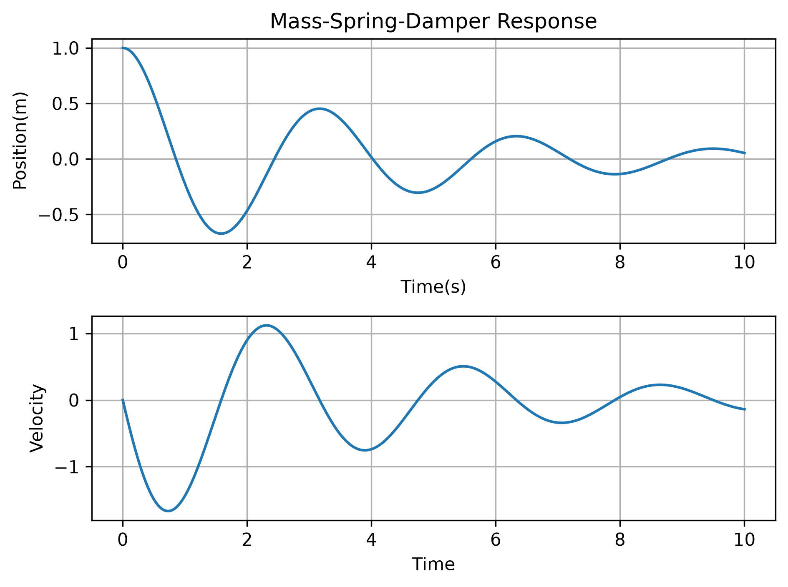

# Intelligent-Dynamics-Control
# Data-Driven Modeling of a Mass-Spring-Damper System Using Machine Learning

**A first project in Intelligent Dynamics and Control**

## 1. Overview

This project investigates the data-driven modeling of a linear mass-spring-damper (MSD) system using machine learning.

A classical physics-based model is first formulated and numerically simulated. The resulting state trajectories are then used to construct a dataset for training a machine learning model. A multi-output Linear Regression model is trained to learn the system dynamics directly from data.

The main objective is to investigate whether a data-driven model can recover the governing dynamics of a known mechanical system.

## 2. Mathematical Model

The dynamics of a free-vibration mass-spring-damper system are governed by:

$$
m\ddot{x}+c\dot{x}+kx=0
$$

where:

- \(m\): Mass
- \(c\): Damping coefficient
- \(k\): Spring stiffness
- \(x\): Displacement

The system parameters are:

| Parameter | Value | Unit |
|---|---:|---|
| Mass (\(m\)) | 1.0 | kg |
| Damping coefficient (\(c\)) | 0.5 | N·s/m |
| Spring stiffness (\(k\)) | 4.0 | N/m |

The governing equation becomes:

$$
\ddot{x}=-0.5\dot{x}-4x
$$

## 3. State-Space Representation

Defining the state vector as:

$$
X=
\begin{bmatrix}
x\\
\dot{x}
\end{bmatrix}
$$

the system can be expressed in state-space form:

$$
\dot{X}=AX
$$

where:

$$
A=
\begin{bmatrix}
0&1\\
-4&-0.5
\end{bmatrix}
$$

The eigenvalues of the system are:

$$
\lambda_{1,2}=-0.25\pm1.9843j
$$

The negative real parts indicate asymptotic stability, while the imaginary parts indicate oscillatory behavior.

## 4. Numerical Simulation

The system response is numerically simulated using Python and SciPy.

Initial conditions:

$$
x(0)=1,\qquad \dot{x}(0)=0
$$

Simulation time:

$$
t\in[0,10]\text{ seconds}
$$

The simulation generates displacement and velocity trajectories, which are subsequently used to construct the machine learning dataset.

## 5. Dataset Construction

The input features and target variables are defined as:

**Input features:**

$$
X_{\text{data}}=
\begin{bmatrix}
x&\dot{x}
\end{bmatrix}
$$

**Target variables:**

$$
Y_{\text{data}}=
\begin{bmatrix}
\dot{x}&\ddot{x}
\end{bmatrix}
$$

Thus, the model learns to predict the time derivatives of the system states from the current state.

## 6. Machine Learning Approach

A multi-output Linear Regression model from Scikit-learn is used to identify the system dynamics.

The workflow consists of:

1. Numerical simulation of the physical system.
2. Dataset generation from simulated state trajectories.
3. Train-test splitting.
4. Feature scaling using StandardScaler.
5. Training a multi-output Linear Regression model.
6. Prediction and performance evaluation.
7. Comparison between learned and physics-based dynamics.

The dataset is divided into training and testing subsets using an 80/20 split.

## 7. Model Evaluation

The model performance is evaluated using the following metrics:

- Mean Absolute Error (MAE)
- Mean Squared Error (MSE)
- Root Mean Squared Error (RMSE)
- Coefficient of Determination (\(R^2\))

Predicted derivatives are compared with the corresponding reference values obtained from the numerical simulation.

## 8. Physics-Based vs. Data-Driven Model

The objective is to compare the learned system matrix with the original physical system matrix:

$$
A_{\text{physical}}=
\begin{bmatrix}
0&1\\
-4&-0.5
\end{bmatrix}
$$

The learned coefficients are transformed back from the scaled feature space to the original physical feature space before comparison.

This comparison provides an indication of how accurately the machine learning model can recover the governing linear dynamics from simulated data.

## 9. Technologies and Libraries

- Python
- NumPy
- SciPy
- Matplotlib
- Pandas
- Scikit-learn
- Jupyter Notebook

## 10. Repository Structure

```text
Intelligent-Dynamics-Control/
│
├── IDC_notebook/
│   └── IDC.ipynb
│
├── .gitignore
└── README.md
```

## 11. How to Run

Clone the repository:

```bash
git clone https://github.com/armiiiiiiiiiiin/Intelligent-Dynamics-Control.git
```

Navigate to the project directory:

```bash
cd Intelligent-Dynamics-Control
```

Install the required libraries:

```bash
pip install numpy scipy matplotlib pandas scikit-learn jupyter
```

Launch Jupyter Notebook:

```bash
jupyter notebook
```

Open:

```text
IDC_notebook/IDC.ipynb
```

Run the notebook cells sequentially.

## 12. Limitations and Future Work

This project is an introductory study of data-driven modeling for mechanical systems.

The training data are generated from a known physical model and a single set of initial conditions. Therefore, the results should be interpreted as a demonstration of model learning and coefficient recovery rather than evidence of generalization to arbitrary mechanical systems.

Potential future extensions include:

- Investigating the effect of measurement noise.
- Generating datasets using multiple initial conditions.
- Studying nonlinear mechanical systems.
- Comparing different regression and machine learning methods.
- Exploring system identification techniques.
- Extending the framework toward data-driven control and reinforcement learning.

## 13. Project Status

Completed: Initial numerical simulation, dataset generation, Linear Regression training, and comparison with the physics-based model.

This project serves as an introductory step toward further studies in intelligent mechanical systems, system identification, and data-driven dynamics and control.

---

**Author:** Armin Moradi
**Field of Interest:** Mechanical Engineering, Dynamics, Vibrations, Control, Robotics and Machine Learning
## Results

### Time Response


### Phase Portrait


### Actual vs. Predicted Velocity



### Actual vs. Predicted Acceleration


### System Matrix Comparison

